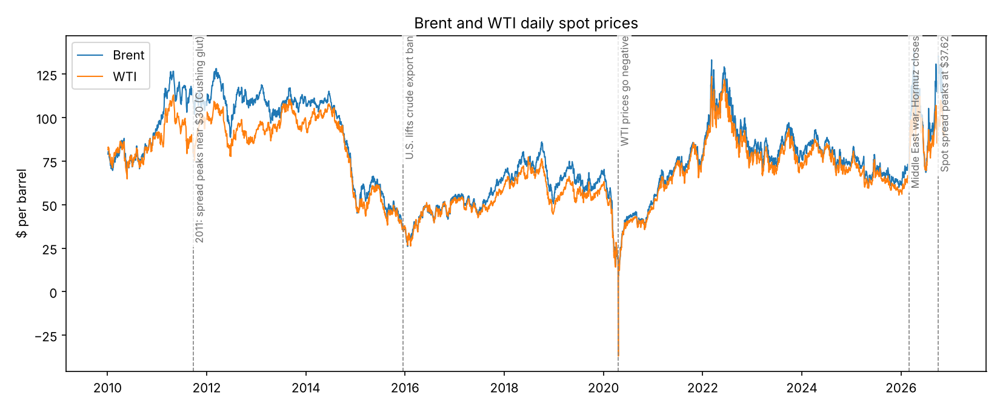
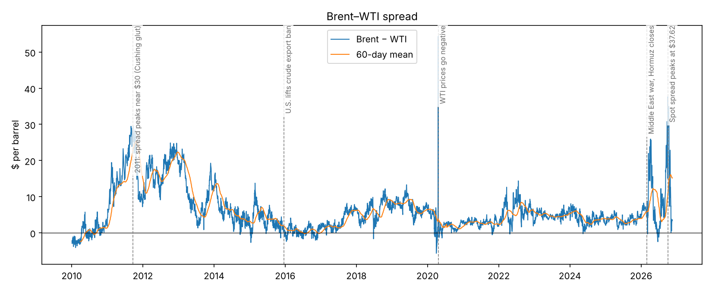
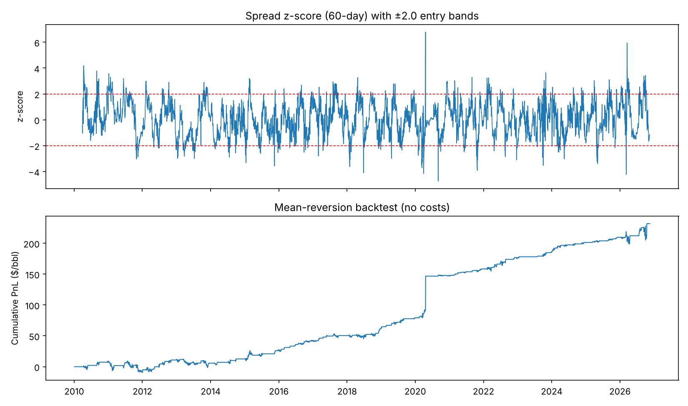

# Brent–WTI Crude Oil Spread Analysis

Brent (North Sea) and WTI (Cushing, Oklahoma) are the two main global crude oil benchmarks. The gap between them, the Brent–WTI spread, reflects transport costs, U.S. supply, export policy, and storage conditions. This project measures how the spread has behaved since 2010, flags unusual moves, and tests whether those moves tend to reverse.

## Questions
1. How large has the spread been, and when did it move most?
2. What events explain the biggest dislocations?
3. Does a simple mean-reversion rule on the spread's z-score have any edge?

## Data
Daily spot prices from the U.S. Energy Information Administration (EIA):
- Brent: series `RBRTE`
- WTI Cushing: series `RWTC`

## Method
- Spread = Brent − WTI ($/barrel)
- 60-day rolling mean and standard deviation; z-score = (spread − mean) / std, computed using only past data
- Dislocation = consecutive days with |z| > 2
- Backtest: short the spread when z > 2, long when z < −2, exit when |z| < 0.5; trades use the next day's move

## Results
- Period: 2010-01-04 to 2026-11-17 (16.9 years, 4,138 trading days)
- Average spread: $6.05/bbl (median $4.51); widest $54.34 on 2020-04-20, narrowest −$5.66 on 2020-03-31
- Annual average spread peaked at $17.61 in 2012 and fell to $0.40 in 2016
- Dislocation episodes (|z| > 2): 218
- 2026 peak: $37.62 on 2026-10-02, the largest since April 2020
- Backtest: 102 trades, 91.2% hit rate, average $2.27/bbl per trade, median holding period 11 trading days
- Risk: annualized Sharpe of 0.69 on daily PnL; max drawdown −$22.57/bbl, all on a single day (2026-10-01 to 10-02) during the Dated Brent squeeze
- Robustness: excluding March–June 2020 cuts total PnL from $231.77 to $166.77/bbl; hit rate was 85.5% before 2020 and 97.4% after
- Daily spread changes have a lag 1 autocorrelation of −0.35, so much of the "edge" is day to day noise reversing





## What I found
**2011–2013: the shale glut.** U.S. shale output grew faster than pipelines could move it out of Cushing, Oklahoma, so WTI was trapped inland and traded far below Brent. The spread peaked at $29.59 on 2011-09-23 and averaged $17.61 in 2012.

**2015–2016: exports reconnect the market.** As pipeline capacity caught up and the U.S. lifted its crude export ban in December 2015, U.S. barrels could reach world markets again. The annual average spread fell to $0.40 in 2016.

**April 2020: storage runs out.** With COVID demand collapsing and storage at Cushing nearly full, WTI spot went negative on 2020-04-20, producing the largest spread in the sample ($54.34) and the largest z-score (6.78).

**2026: the Strait of Hormuz.** After military action in the Middle East on February 28, 2026 and the de facto closure of the Strait of Hormuz, Brent (the seaborne benchmark) absorbed the supply shock while WTI stayed relatively insulated. The spot spread jumped from $4.75 on March 13 to $21.97 on March 18. It collapsed to an average of $0.83 in June on hopes of a peace framework, then blew out again in the fall as physical cargoes and freight costs soared, peaking at $37.62 on 2026-10-02. When U.S.-Iran talks progressed and Hormuz flows recovered in November, the spread fell back to about $3.

**Spot vs. futures.** In early October 2026 the futures spread was roughly $11 to $13, while the EIA spot spread was above $30. Spot Brent reflects physical North Sea cargoes, which were squeezed far harder than the futures contract. The two measures can tell very different stories during a crisis.

**The backtest is too good to trust, and the risk numbers show why.** A 91% hit rate came with a Sharpe of only 0.69, because the few losses were large: the worst single day (−$22.57/bbl) erased the profit of about ten average trades. Daily spread changes have a −0.35 autocorrelation: a move one day tends to reverse the next. Brent and WTI spot prices are assessed at different times and places, so part of what the rule "trades" is timing noise, not a real opportunity. Removing March–June 2020 alone cuts total PnL by 28%. A real test would use futures, include transaction and roll costs, and tune parameters out of sample.

## Limitations
- Spot prices can't be traded directly; a real trade would use futures (and roll costs)
- No transaction costs, slippage, or position sizing
- Parameters (60-day window, ±2 entry) were not optimized out of sample
- Extreme days like April 2020 dominate the statistics
- Sharpe is computed on daily PnL in $/bbl with no capital base, so it measures consistency, not return on capital
- Brent and WTI spot prices are assessed at different times of day, which creates noise that reverses the next day; a strong negative autocorrelation (−0.35) suggests the backtest overstates any real, tradable edge

## Run it
```bash
pip install -r requirements.txt
python run_analysis.py              # downloads EIA spreadsheets, no key needed
python run_analysis.py --xls-dir data   # or use RBRTEd.xls and RWTCd.xls saved in data/
pytest -q                           # tests also run automatically on GitHub Actions
```
